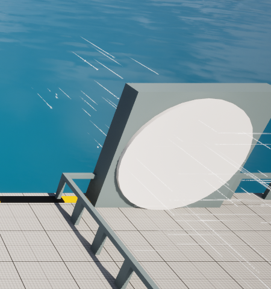
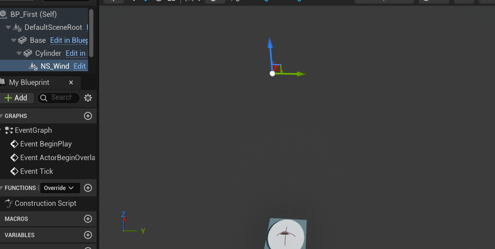

Due to how the Niagara system works, when you increase the length of the particle area, it extends in both directions. This causes the issue that the particles begin before the actual source of the particles, as seen below:

However, this is an incredibly easy fix! Simply go into the blueprint for the fan you want to adjust and move the "NS_Wind" component to be further away from the Static Mesh components, just like below:

